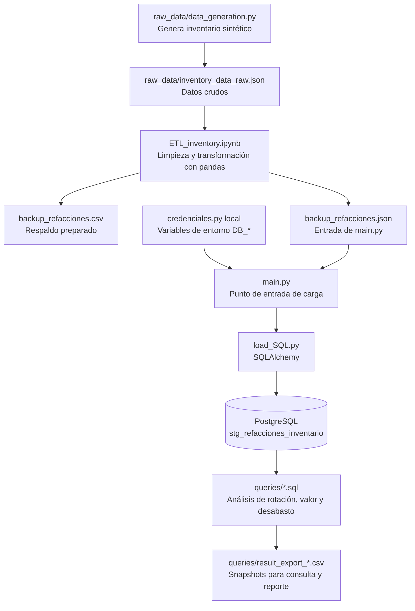

# Inventory API — análisis de inventario de refacciones

## Descripción

Proyecto de análisis de inventario que genera datos sintéticos, los prepara con pandas, conserva respaldos CSV/JSON y carga el conjunto preparado a una tabla de staging en PostgreSQL. Las consultas SQL de `queries/` producen análisis para priorizar reposición, revisar rotación y localizar capital concentrado en refacciones.

La fuente actual es simulada: no consume una API externa ni representa inventario operativo. Los registros se generan aleatoriamente y las exportaciones incluidas son snapshots; por ello, no se deben interpretar como cifras vigentes ni como garantía de resultados reproducibles.

## Estructura modular

| Módulo o carpeta | Responsabilidad |
|---|---|
| [`raw_data/data_generation.py`](./raw_data/data_generation.py) | Define `fetch_inventory()` y genera 100 registros sintéticos para cuatro sucursales y cinco categorías. Al ejecutar el módulo escribe `raw_data/inventory_data_raw.json`. |
| [`ETL_inventory.ipynb`](./ETL_inventory.ipynb) | Lee el JSON crudo, prepara tipos y columnas derivadas, muestra los datos y exporta los respaldos CSV/JSON. |
| [`load_SQL.py`](./load_SQL.py) | Expone `load_to_postgres(df, connection_string)`, crea el motor SQLAlchemy y reemplaza la tabla `stg_refacciones_inventario`. |
| [`main.py`](./main.py) | Punto de entrada de carga: lee `backup_refacciones.json`, obtiene la conexión y carga los datos a PostgreSQL. No ejecuta la transformación del notebook. |
| [`queries/`](./queries) | Contiene tres consultas SQL analíticas y sus exportaciones CSV de resultados. |
| [`backup_refacciones.csv`](./backup_refacciones.csv), [`backup_refacciones.json`](./backup_refacciones.json) | Respaldos preparados que consume el punto de entrada. Pueden corresponder a una ejecución distinta a los CSV de consultas. |

El generador produce IDs `KW-1001` a `KW-1100`, nombres de componente, categoría, sucursal, existencias, mínimo, costo unitario en USD, ventas del último mes y fecha de actualización. Las sucursales son Comanjilla, Leon Centro, Silao Ops y Celaya Hub; las categorías, Sistema de frenos, Motor PACCAR, Filtracion, Suspension y Electrico. Los datos no usan una semilla fija.

## Flujo de datos



La tabla de staging debe estar cargada antes de ejecutar las consultas SQL. El repositorio incluye SQL y exportaciones, pero no un ejecutor automático de las consultas ni una actualización automática de esos CSV.

## Preparación y ejecución

### Requisitos

- Python.
- `pandas`, `SQLAlchemy` y el controlador PostgreSQL `psycopg2`.
- PostgreSQL con una base de datos accesible.
- Jupyter Notebook para ejecutar el flujo de transformación del notebook.

### 1. Generar los datos crudos

Desde la raíz del proyecto:

```powershell
python -m raw_data.data_generation
```

Esto genera o reemplaza `raw_data/inventory_data_raw.json`.

### 2. Transformar y guardar respaldos

Abre [`ETL_inventory.ipynb`](./ETL_inventory.ipynb) desde la raíz y ejecuta sus celdas en orden. El notebook lee `raw_data/inventory_data_raw.json`, calcula campos derivados y guarda `backup_refacciones.csv` y `backup_refacciones.json` en la raíz.

### 3. Configurar y ejecutar la carga a PostgreSQL

#### Cifrar la contraseña de conexión

El módulo local `credenciales.py` usa Fernet para cifrar y descifrar la contraseña. Instala su dependencia si aún no está disponible:

```powershell
python -m pip install cryptography
```

Genera una clave Fernet una sola vez y guárdala en un gestor de secretos o en otro lugar seguro fuera del repositorio:

```powershell
python -c "from credenciales import generar_llave_cifrado; print(generar_llave_cifrado())"
```

No es necesario regenerar la clave para una contraseña cifrada ya existente: solo la clave original puede descifrarla. No guardar ni compartir la clave junto con el valor cifrado. Para cada nueva sesión de PowerShell, solo es necesario cargar la clave guardada de forma segura y configura el usuario de la base de datos:

```powershell
$env:DB_ENCRYPTION_KEY = "<clave Fernet guardada de forma segura>"
$env:DB_USER = "<usuario de PostgreSQL>"
```

Introducir la contraseña de forma interactiva para cifrarla en la sesión, sin escribirla directamente en el comando:

```powershell
$env:DB_PASSWORD_ENCRYPTED = (python -c "import os; from getpass import getpass; from credenciales import cifrar_contrasena; print(cifrar_contrasena(getpass('Contraseña DB: '), os.environ['DB_ENCRYPTION_KEY']))")
```
>La sección anterior sobre cifrado de la contraseña del servidor de la base de datos solo se ha adjuntado en este proyecto por motivos de seguridad del presente desarrollador.  


`main.py` llama a `crear_db_conn()`, que valida estas tres variables, descifra la contraseña en memoria y construye la URL SQLAlchemy para la carga. Si falta una variable o la clave no corresponde al texto cifrado, la conexión no se crea.

Opcionalmente, configura `$env:DB_HOST`, `$env:DB_PORT` y `$env:DB_NAME`. Si no se indican, se usan `localhost`, `5432` y `kenworth_db`. El cifrado no sustituye un gestor de secretos: protege el valor cifrado, pero quien obtenga la clave puede recuperar la contraseña. No imprimas la clave, el valor descifrado ni la URL de conexión en logs.

Con PostgreSQL y la base de datos disponibles, ejecuta:

```powershell
python main.py
```

`main.py` carga el JSON preparado en `stg_refacciones_inventario`, reemplazando el contenido de la tabla. Antes de usar `main.py`, asegúrate de que `backup_refacciones.json` existe y contiene los campos requeridos por los análisis SQL.

## Consultas SQL y utilidad de los resultados

Las tres consultas operan sobre `stg_refacciones_inventario`. Sus CSV asociados son resultados exportados previamente: sirven como ejemplos de salida e insumo para revisión o presentación, pero no se actualizan automáticamente y pueden provenir de una muestra distinta a los respaldos actuales.

| Consulta y resultado | Qué calcula | Utilidad comercial | Utilidad técnica |
|---|---|---|---|
| [`Rotacion_inventario.sql`](./queries/Rotacion_inventario.sql) → [`result_export_rotacion_inventario.csv`](./queries/result_export_rotacion_inventario.csv) | Agrega por sucursal y categoría: SKUs, stock, ventas, capital invertido e índice de rotación; asigna un diagnóstico. | Ayuda a detectar categorías que podrían requerir reposición acelerada o atención por baja rotación, orientando decisiones de compra y revisión de inventario inmovilizado. | Demuestra agregaciones con CTE, cálculo condicional para evitar división por cero y clasificación derivada. El índice es una razón de ventas del último mes sobre stock, no una rotación anualizada. |
| [`Ranking_valor_Inventario.sql`](./queries/Ranking_valor_Inventario.sql) → [`result_export_ranking_valor_inventario.csv`](./queries/result_export_ranking_valor_inventario.csv) | Ordena por valor estimado (stock × costo unitario) y devuelve los rangos 1 a 3 por sucursal mediante `DENSE_RANK()`; los empates pueden producir más de tres filas por sucursal. | Visibiliza dónde se concentra el valor almacenado y qué artículos conviene priorizar para control, conteo cíclico y revisión de exposición financiera. | Ejemplifica una función de ventana particionada por sucursal y conserva empates en las posiciones del ranking. |
| [`Alerta_operativa_desabasto.sql`](./queries/Alerta_operativa_desabasto.sql) → [`result_export_alerta_operativa_desabasto.csv`](./queries/result_export_alerta_operativa_desabasto.csv) | Filtra estados críticos y de reorden; estima días de cobertura con stock / ventas mensuales × 30. | Facilita priorizar acciones de reabastecimiento y revisar artículos con riesgo de interrupción de servicio. | Usa `NULLIF` para evitar división entre cero; cuando las ventas son cero, la cobertura queda `NULL` y no representa una estimación numérica. |

### Lectura de los snapshots incluidos

Los archivos CSV actuales contienen:

- **Rotación:** 20 grupos sucursal-categoría: 11 con diagnóstico `ALTA ROTACION / RIESGO DESABASTO` y 9 `ROTACION SALUDABLE`. En esta exportación no aparecen grupos con baja rotación. El índice varía de 0.92 a 5.49.
- **Ranking por valor:** 12 filas, tres posiciones por cada una de las cuatro sucursales. El mayor valor exportado es KW-1091 en Comanjilla, con USD 158,394.56.
- **Alertas:** 18 filas: 2 con `DESABASTO_CRITICO` y 16 con `REORDEN_REQUERIDO`. Las dos críticas tienen stock cero y cobertura estimada de cero días.

Son cifras descriptivas de los archivos exportados, no pronósticos ni indicadores en tiempo real. Antes de tomar decisiones de compra, valida los resultados con una carga consistente, costos vigentes, reglas de negocio acordadas y datos reales.

## Campos preparados

| Campo | Descripción |
|---|---|
| `refaccion_id`, `nombre_parte` | Identificador y nombre sintéticos de la pieza. |
| `categoria`, `sucursal` | Clasificación del artículo y ubicación. |
| `stock_actual`, `stock_minimo` | Existencias disponibles y umbral mínimo. |
| `costo_unitario_usd` | Costo unitario sintético en dólares estadounidenses. |
| `ventas_ultimo_mes` | Unidades vendidas durante el último mes. |
| `fecha_ultima_actualizacion` | Fecha de actualización del registro. |
| `valor_inventario_total` | Valor calculado del inventario (stock × costo unitario). |
| `estado_inventario` | Estado calculado durante el procesamiento de los datos. |

## Consideraciones y limitaciones

- La generación aleatoria no fija semilla; las ejecuciones nuevas no reproducen necesariamente respaldos y exportaciones existentes.
- Los respaldos y los resultados de `queries/` no constituyen una única instantánea consistente. No se deben comparar sus totales como si procedieran de la misma carga.
- El notebook y los CSV disponibles representan el proceso de preparación actual. `main.py` realiza la carga del JSON preparado, no el ETL completo.
- La utilidad comercial de las consultas es orientativa: los datos, costos y ventas son sintéticos y las etiquetas de diagnóstico son reglas simplificadas.
- La consulta de rotación usa ventas de un mes sobre stock actual; requiere interpretación con el periodo, la disponibilidad y las políticas de inventario del negocio.
- La estimación de cobertura supone que las ventas mensuales representan un ritmo de consumo aplicable a los próximos 30 días. Si no existen ventas, devuelve `NULL`.
